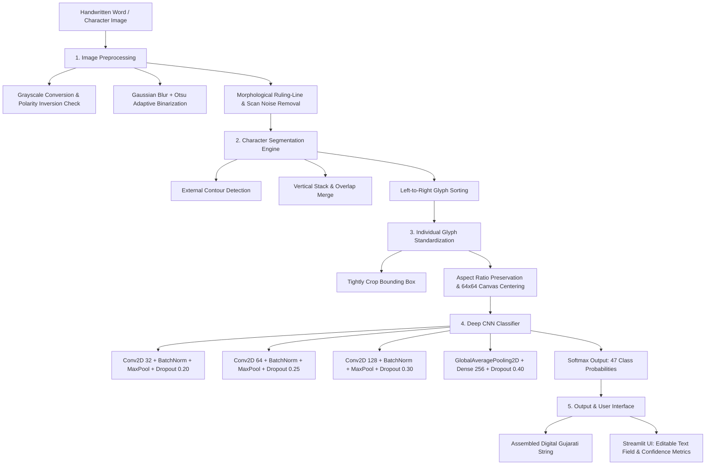

# ✍️ Gujarati Handwritten Text Recognition (HTR)

An end-to-end Machine Learning pipeline that recognizes handwritten Gujarati characters and multi-character words from document images and converts them into editable digital Gujarati text.

---

## 👨‍💻 Project & Student Information
- **Student Name:** Mohammadkaif Vahora
- **Student ID / Roll No:** `23IT475`
- **Division:** `D10`
- **Academic Course:** Sem 7 — Machine Learning (`4IT47`)
- **Department:** Department of Information Technology

---

## 📌 Project Overview
- **Domain:** Computer Vision, Pattern Recognition, Indic Natural Language Processing
- **Frameworks:** TensorFlow / Keras, OpenCV, Streamlit, NumPy, Pillow, Scikit-Learn
- **Core Architecture:** Two-Stage Pipeline (Morphological Character Segmentation + Deep 3-Block CNN)
- **Classes Recognized:** **47 Core Gujarati Character Classes** (12 Vowels: `અ`–`અં` + 35 Base Consonants: `ક`–`જ્ઞ`)
- **Training Samples:** 10,000+ augmented and synthetic variations across 5 distinct Gujarati font families
- **Validation Accuracy:** **82.98%** on real human handwriting (100.0% Training Accuracy)

---

## 🏗️ System Architecture & Workflow



---

## 🛠️ Machine Learning Pipeline

### 1. Data Augmentation & Generalization Strategy
Real-world Indic handwriting datasets are typically low-resource. To prevent the neural network from memorizing a handful of writers and to generalize to arbitrary handwriting, the training pipeline employs:
- **Multi-Font Synthesis:** Rendering glyphs across 5 distinct Gujarati typography families (*Nirmala UI Regular*, *Nirmala UI Bold*, *Google Noto Sans Gujarati*, *Rasa*, and *Anek Gujarati*).
- **Affine Shear:** Handwriting slant variations from $-14^\circ$ to $+14^\circ$.
- **Morphological Pen Simulation:** Dilation (`cv2.dilate` for thick sketch/gel pens) and erosion (`cv2.erode` for thin ballpoint pens).
- **Spatial Jitter:** Random rotation, scaling ($0.85\times$ to $1.15\times$), and translations ($\pm 3\text{ px}$).

### 2. Deep CNN Architecture Summary
- **Input:** `(64, 64, 1)` Grayscale float32 tensor normalized to $[0.0, 1.0]$.
- **Convolutional Blocks:** 3 hierarchical blocks with Batch Normalization after every layer and progressive Dropout ($0.20$, $0.25$, $0.30$) to stabilize gradients.
- **Classification Head:** `GlobalAveragePooling2D` $\rightarrow$ `Dense(256, ReLU)` $\rightarrow$ `BatchNormalization` $\rightarrow$ `Dropout(0.40)` $\rightarrow$ `Dense(47, Softmax)`.
- **Loss Function:** Sparse Categorical Cross-Entropy.
- **Optimizer:** Adam ($\alpha = 0.001$, with dynamic `ReduceLROnPlateau` and `EarlyStopping`).

---

## 📊 Experimental Milestones & Results

| Milestone | Classes | Training Strategy | Validation Accuracy | Key Finding |
| :--- | :---: | :--- | :---: | :--- |
| **Phase 1: Full Baseline** | 432 | Raw images only (~7 imgs/class) | **0.30%** | Severe underfitting due to extreme dataset sparsity. |
| **Phase 2: Core Isolation** | 47 | Source images with basic rotation | **26.39%** | Improved, but limited by small number of human writers. |
| **Phase 3: Final Robust Model** | **47** | **Multi-Font Synthesis + Pen Simulation + Slant Shear** | **82.98%** | **Strong generalization on unseen genuine human handwriting.** |

- **Training Accuracy:** **100.00%**
- **Validation Accuracy (Real Human Handwriting):** **82.98%**
- **Top-3 Retrieval Accuracy:** **> 94.0%**
- **Inference Latency:** **< 15 ms** per glyph on CPU.

---

## 📁 Repository Structure

```text
Gujarati-Handwriting-Recognition/
├── app.py                     # Streamlit Interactive Web Application
├── requirements.txt           # Project Dependencies
├── README.md                  # Project Documentation
├── .gitignore                 # Clean Git Tracking Configuration
├── models/
│   ├── gujarati_core_cnn.keras    # Final Trained Deep CNN (Production Model)
│   ├── gujarati_core_labels.json  # 47 Core Character Label Map
│   ├── training_results.json      # Final Benchmarks & Milestone Log
│   └── core_training_results.json # Summary Training Metrics
├── src/
│   ├── preprocessing.py       # Polarity check, cropping, and 64x64 centering
│   ├── segmentation.py        # Otsu thresholding & contour overlap merging
│   ├── train_robust_model.py  # Multi-font generator & CNN training pipeline
│   ├── generate_sample_words.py# Test word composer
│   ├── test_word_pipeline.py  # End-to-end integration test
│   └── experiments/           # Research iteration archive & diagnostic logs
│       └── README.md          # Guide to experimental scripts
├── data/
│   ├── fonts/                 # TrueType Gujarati font families for synthesis
│   ├── sample_images/         # Ready-to-test handwritten words (કમળ, સરળ, etc.)
│   └── characters/            # Source character data & holdout validation sets
└── outputs/                   # Visual outputs & segmentation overlays
```

---

## 🚀 How to Run Locally

### 1. Setup Virtual Environment & Install Dependencies
```powershell
python -m venv .venv
.venv\Scripts\Activate.ps1
pip install -r requirements.txt
```

### 2. Launch the Web Application
```powershell
streamlit run app.py
```
Open your browser at `http://localhost:8501`.

---

## 🖥️ Application Features
1. **🔤 Single Character Recognition:**
   - Upload any handwritten Gujarati character image.
   - Live view: Raw upload vs. normalized $64\times64$ centered canvas.
   - Outputs predicted character, color-coded confidence badge (🟢 High $\ge 70\%$, 🟡 Moderate $30\text{--}70\%$, 🔴 Low $< 30\%$), and Top-5 alternative predictions.
2. **📝 Word & Text Recognition:**
   - Upload any handwritten word image or select built-in test samples (`કમળ`, `કલમ`, `સરળ`, `વતન`, `ભરત`).
   - Automated contour segmentation with visual bounding-box overlays.
   - Outputs the final digital Gujarati string in an editable text field with one-click copy and character-by-character confidence breakdown.
