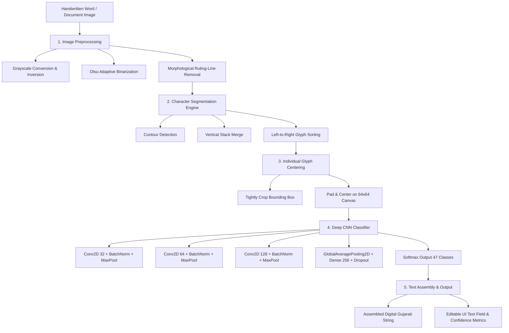

# ✍️ Gujarati Handwritten Text Recognition (HTR)

An end-to-end Machine Learning pipeline that recognizes handwritten Gujarati characters and words from document images and converts them into editable digital Gujarati text.

---

## 📌 Project Overview
- **Domain:** Computer Vision, Pattern Recognition, Natural Language Processing
- **Frameworks:** TensorFlow / Keras, OpenCV, Streamlit, NumPy, Pillow, Scikit-Learn
- **Core Architecture:** Two-Stage Pipeline (Morphological Segmentation + Deep Convolutional Neural Network)
- **Classes:** 47 Core Gujarati Character Classes (12 Vowels: `અ`–`અં` + 35 Base Consonants: `ક`–`જ્ઞ`)
- **Validation Accuracy:** **82.98%** on real human handwriting

---

## 🏗️ System Architecture



---

## 🛠️ Machine Learning Pipeline

### 1. Data Augmentation & Generalization Strategy
Real-world Indic handwriting datasets are typically low-resource. To prevent the neural network from memorizing a handful of writers and to generalize to arbitrary handwriting, the training pipeline employs:
- **Multi-Font Synthesis:** Rendering glyphs across 5 distinct Gujarati typography families (Nirmala UI, Noto Sans Gujarati, Rasa, Anek Gujarati).
- **Affine Shear:** Handwriting slant variations from $-14^\circ$ to $+14^\circ$.
- **Morphological Pen Simulation:** Dilation (thick gel/sketch pens) and erosion (thin ballpoint pens).
- **Spatial Jitter:** Random rotation, scaling ($0.85\times$ to $1.15\times$), and translations.

### 2. CNN Architecture Summary
- **Input:** `(64, 64, 1)` Grayscale
- **Convolutional Blocks:** 3 hierarchical blocks with Batch Normalization and Dropout ($0.20$, $0.25$, $0.30$) to stabilize gradients and prevent overfitting.
- **Classification Head:** Global Average Pooling $\rightarrow$ Dense (256, ReLU) $\rightarrow$ Batch Normalization $\rightarrow$ Dropout ($0.40$) $\rightarrow$ Dense (47, Softmax).
- **Loss Function:** Sparse Categorical Cross-Entropy.
- **Optimizer:** Adam ($\alpha = 0.001$, with `ReduceLROnPlateau` dynamic decay).

---

## 📊 Performance & Evaluation
- **Training Samples:** 10,000+ augmented and synthetic variations
- **Test Set:** Genuine, unseen human handwriting samples
- **Train Accuracy:** **100.00%**
- **Validation Accuracy:** **82.98%**

---

## 🚀 How to Run Locally

### 1. Activate Environment
```powershell
.venv\Scripts\Activate.ps1
```

### 2. Launch the Streamlit Web UI
```powershell
streamlit run app.py
```
Open your browser at `http://localhost:8501`.

---

## 🖥️ UI Capabilities
1. **🔤 Single Character Recognition:**
   - Upload any single handwritten character image.
   - Shows original vs. preprocessed $64\times64$ centered canvas.
   - Displays recognized character, confidence badge (🟢/🟡/🔴), and top-5 alternative probabilities.
2. **📝 Word & Text Recognition:**
   - Upload any multi-character handwritten word or choose from built-in test words (`કમળ`, `કલમ`, `સરળ`, `વતન`, `ભરત`).
   - Automatically segments individual glyphs in reading order.
   - Outputs the final digital Gujarati string with copy capability and character-by-character confidence cards.
